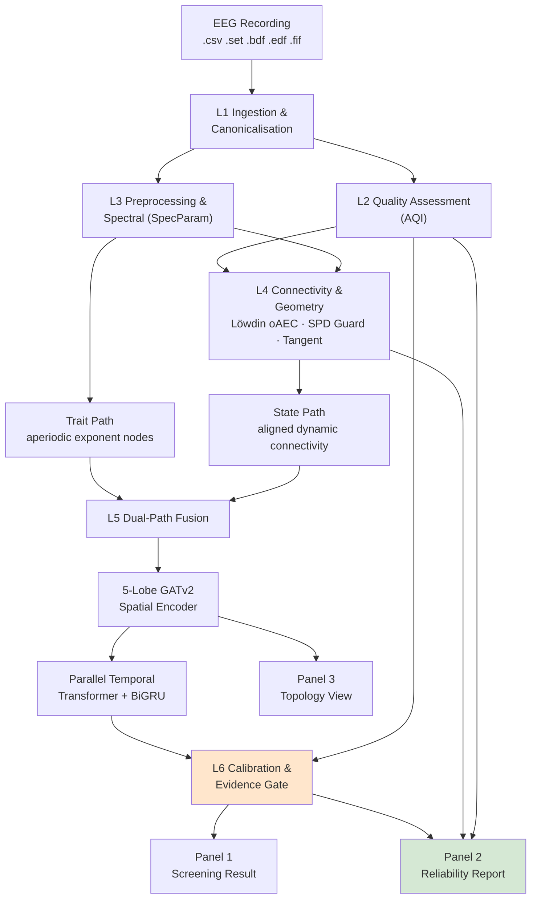

# 07 — System Architecture

## 1. Architecture Overview

The system is a unidirectional pipeline of seven layers with three terminal presentation surfaces.
Data flows forward only; the single feedback path is the evidence gate controlling whether a
prediction is released.

## 2. Architectural Layers

| Layer | Name | Responsibility |
|---|---|---|
| L1 | Ingestion & Canonicalisation | Accept multi-format input; resolve channel names to canonical montage; validate schema |
| L2 | Quality Assessment | Compute Artifact Quality Index; detect flatline, clipping, blink burden, muscle burden |
| L3 | Preprocessing & Spectral | Trend removal, bad-channel rule, band separation, SpecParam fit |
| L4 | Connectivity & Geometry | Joint Löwdin orthogonalisation, envelope correlation, SPD guard, tangent projection, alignment |
| L5 | Representation & Encoders | Dual-path fusion; five-lobe GATv2; parallel temporal encoder |
| L6 | Calibration & Evidence Gate | Probability calibration; abstention decision; operating-point selection |
| L7 | Presentation | Three panels: screening, reliability, topology |

Supporting cross-cutting concerns: reproducibility ledger (versions, config hash, checkpoint hash,
seed), attrition recorder (per-group exclusion accounting), and connectivity-integrity recorder (SPD
correction statistics).

## 3. Major Components and Responsibilities

### 3.1 Ingestion Component

- Accepts `.csv`, `.set`, `.bdf`, `.edf`, `.fif`.
- Resolves channel names through a bidirectional mapping: modern 10–20 (`T7`, `T8`, `P7`, `P8`),
  legacy 10–20 (`T3`, `T4`, `T5`, `T6`), and 128-channel net names (`E11`→`Fz`, `E45`→`T7`, `E129`→`Cz`,
  `E22`→`Fp1`).
- Emits a matrix in fixed canonical 19-channel order and a provenance record.
- Rejects or imputes missing channels; imputation is recorded.

### 3.2 Quality Component

- Computes band-limited power ratios: muscle-band to low-band ratio, blink-band amplitude, global
  amplitude dispersion.
- Detects flatline and clipping.
- Emits a scalar AQI and a per-window quality vector.

### 3.3 Preprocessing Component

- Trend removal (high-pass / detrend).
- Reference bad-channel rule: robust deviation (median absolute deviation z > 5.0), maximum neighbour
  correlation < 0.40, predictability R² < 0.75, flatline variance < 1e-10.
- Band separation into contiguous, non-overlapping clinical bands.
- SpecParam fit over 1–40 Hz with an R² ≥ 0.85 acceptance criterion; emits exponent χ and offset A.

### 3.4 Connectivity Component

- Global joint Löwdin orthogonalisation of the channel matrix.
- Hilbert envelope extraction.
- Envelope Pearson correlation → connectivity matrix.
- SPD guard: eigendecomposition, clipping at ε = 1e-6, recording L1 correction magnitude.

### 3.5 Geometry Component

- Fréchet (geometric) mean of a set of covariance matrices.
- Tangent-space projection at the reference.
- Alignment arms: none, Euclidean alignment, Riemannian re-centering, band-limited Riemannian.

### 3.6 Representation Component

- Trait path: aperiodic exponent per channel as gain-invariant node priors.
- State path: aligned dynamic connectivity, windowed.
- Fusion: concatenation with a learned combination layer.

### 3.7 Encoder Component

- Spatial: five-lobe, 19-node GATv2 with learnable sparse edge gate.
- Temporal: parallel Transformer encoder and bidirectional GRU over 10-window sequences.
- Output: participant-level embedding.

### 3.8 Decision Component

- Calibration (probability mapping; Brier and ECE monitored).
- Operating-point selection at a target sensitivity.
- Evidence gate: accept/abstain from AQI and a coverage target.

### 3.9 Presentation Component

- Panel 1: index, operating point, PPV at 5%/10%, abstention state, plain-language summary.
- Panel 2: risk–coverage curve, per-group attrition table, window timeline, reproducibility badge,
  connectivity-integrity line.
- Panel 3: 19-node scalp graph coloured by exponent, pruned by learned gate, split-half stability
  metric.

## 4. Interfaces

| Interface | Producer → Consumer | Payload |
|---|---|---|
| I1 | Ingestion → Quality, Preprocessing | Canonical matrix, provenance record |
| I2 | Quality → Decision, Presentation | AQI scalar, per-window quality vector |
| I3 | Preprocessing → Connectivity, Representation | Band-limited signals, exponent/offset arrays |
| I4 | Connectivity → Geometry | Connectivity matrices, SPD correction statistics |
| I5 | Geometry → Representation | Tangent vectors, aligned matrices |
| I6 | Representation → Encoder | Fused node features, edge weights |
| I7 | Encoder → Decision | Participant-level embedding |
| I8 | Decision → Presentation | Probability, evidential state, operating point |
| I9 | All → Presentation | Integrity statistics, attrition records, ledger |

## 5. Dependencies

- Ingestion depends on the canonical montage definition.
- Connectivity depends on preprocessing output and on the orthogonalisation routine.
- Representation depends on both the exponent array (trait) and the geometric pipeline (state); a
  failure of the SpecParam acceptance criterion degrades the trait path and must be handled explicitly
  rather than silently substituted.
- Encoder depends on graph construction from the montage.
- Decision depends on calibration statistics computed on held-out folds only.

## 6. Communication Mechanisms

The implementation is a single-process, in-memory pipeline. Inter-component communication is by typed
data structures (arrays and records). No network transport is required for the offline mode. The
presentation layer reads a serialised result record; the same record is the artefact persisted for
reproducibility.

## 7. Input/Output Relationships

**Input.** One recording: multichannel time series plus sampling rate and channel labels.

**Intermediate.** Canonical matrix; AQI; filtered bands; exponent/offset arrays; connectivity matrices;
tangent vectors; node features; edge weights; participant embedding.

**Output.** A result record containing: calibrated index; evidential state; operating point
(sensitivity, specificity); PPV at 5% and 10%; per-window quality timeline; risk–coverage curve;
attrition counts; SPD integrity statistics; graph with stability metric; reproducibility ledger.

## 8. Architecture Diagram

See `diagrams/system_architecture.mmd`.

## 9. Architectural Constraints

1. No component may emit a diagnostic label; the decision component's codomain is
   (probability, evidential state).
2. No matrix may enter a geometric operation without passing the SPD guard.
3. Calibration statistics are computed only on training folds; test-fold statistics are never used.
4. The presentation layer is read-only over the result record; it performs no inference.
5. Every output record carries a reproducibility ledger.
