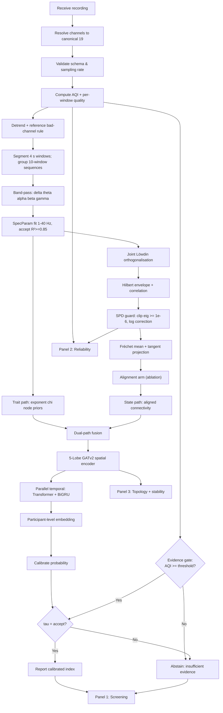

# 09 — System Workflow and Methodology

## 1. Methodological Phases

| Phase | Name | Output |
|---|---|---|
| M1 | Acquisition and canonicalisation | Canonical 19×N matrix, provenance |
| M2 | Quality assessment | AQI, per-window quality |
| M3 | Preprocessing and spectral decomposition | Bands, χ, A, acceptance flags |
| M4 | Connectivity construction | PSD-guaranteed matrices, SPD statistics |
| M5 | Geometric projection and alignment | Tangent vectors, aligned matrices |
| M6 | Dual-path representation | Node features, edge weights |
| M7 | Spatio-temporal encoding | Participant embedding |
| M8 | Calibration and gating | p̂, τ, operating point, PPVs |
| M9 | Presentation and audit | Three panels, ledger |

## 2. End-to-End Execution Sequence

1. **Ingest.** Load the recording; resolve channel labels to canonical order; record provenance.
2. **Assess.** Compute AQI and per-window quality; flag unusable windows.
3. **Preprocess.** Detrend; apply the reference bad-channel rule; segment into 4-second windows and
   group into 10-window sequences; band-pass.
4. **Decompose.** Fit the spectral model over 1–40 Hz; accept fits with R² ≥ 0.85; extract exponent χ.
5. **Connect.** For each retained window: joint Löwdin orthogonalisation → envelope → correlation.
6. **Guard.** Eigendecompose each matrix; clip at ε = 1e-6; record corrections.
7. **Project.** Fréchet mean over the reference; tangent projection.
8. **Align.** Apply the selected alignment arm (ablation knob; production default is *not yet
   finalised*).
9. **Represent.** Build trait-path node features from χ and state-path node features from aligned
   connectivity; fuse.
10. **Encode.** Graph attention over the five-lobe montage; temporal encoding over window sequences;
    participant pooling.
11. **Calibrate.** Map to probability using training-fold calibration statistics.
12. **Gate.** Decide accept/abstain from AQI and coverage target.
13. **Report.** Emit the result record; render the three panels.

## 3. Computational Logic per Phase

**M3 — Spectral decomposition.** For each channel-window, the power spectral density is modelled as
aperiodic plus periodic components. The aperiodic component in log-log space is linear:
L(f) = b − χ·log(f). A linear fit over the full 1–40 Hz range, following removal of detected peaks,
yields χ and b. Fit quality is measured by R²; fits below 0.85 are flagged and excluded from the trait
path.

**M4 — Connectivity.** The decisive step is orthogonalising *jointly* across channels before envelope
extraction. Pairwise orthogonalisation would orthogonalise channel pairs independently, which does not
produce a consistent Gram matrix. Joint orthogonalisation produces a set of mutually orthogonalised
vectors whose correlation matrix is a genuine Gram matrix and therefore positive semi-definite.

**M5 — Geometry.** Covariance matrices do not form a vector space. The arithmetic mean of two matrices
generally lies "off" the geodesic between them, and averaging distorts eigenvalues. The Fréchet mean
minimises the sum of squared geodesic distances and is the correct reference. Projection to the tangent
space at that reference linearises the manifold locally, permitting linear classifiers to be applied
validly.

**M8 — Calibration.** The mapping from logit to probability is fitted on training folds only and applied
to test folds. Reliability is monitored by expected calibration error and Brier score. The operating
threshold is selected to achieve a target sensitivity on training folds, then evaluated on test folds.
PPV is computed analytically from the retained sensitivity/specificity pair at the stated prevalence.

## 4. Decision Logic

The decision component implements two nested decisions.

**Outer (evidence gate).** Given AQI and a coverage target κ, decide whether the recording is admissible.
If inadmissible, τ = abstain and no probability is shown; the panel reports the reason.

**Inner (classification).** If admissible, threshold the calibrated probability at the operating point
selected for the target sensitivity; report p̂ and τ = accept.

The gate is the mechanism that converts quality information into specificity: abstaining on low-quality
recordings removes a class of systematically unreliable predictions.

## 5. Workflow Diagram

See `diagrams/system_workflow.mmd`.

## 6. Error and Degradation Handling

| Condition | Behaviour |
|---|---|
| Missing channel | Median impute; record in provenance; reduce confidence |
| Flatline channel | Exclude per bad-channel rule; record in attrition |
| SpecParam fit fails acceptance | Exclude that window from the trait path; record; do not silently substitute |
| SPD correction large | Retain matrix; flag in Panel 2 as low reliability |
| All windows fail quality | τ = abstain with reason "no admissible segments" |
| Calibration unreliable | Widen gate; reduce coverage; report |

## 7. Methodological Constraints

1. All thresholds (bad-channel, SpecParam acceptance, operating point, AQI gate) are fitted on training
   folds and frozen before test evaluation.
2. Participant-level aggregation precedes metric computation.
3. No test-fold information may influence calibration or gate selection.
4. Every exclusion is recorded with group membership for attrition reporting.
