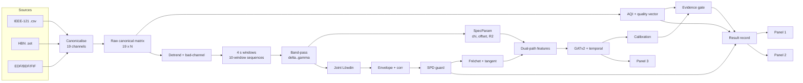

# 11 — Data and Information Flow

## 1. Data Sources

### 1.1 Primary Cohort (Benchmark)

| Attribute | Value |
|---|---|
| Name | IEEE DataPort ADHD-Child cohort (Nasrabadi et al., 2020; DOI 10.21227/rzfh-zn36) |
| Composition | 121 children (61 ADHD, 60 control) |
| Channels | 19, standard 10–20 |
| Sampling rate | 128 Hz |
| Paradigm | Resting with a visual counting task |
| Format | CSV (single file, one row per sample, label and subject ID per row) |
| Known structure | Per-child duration 62–338 s; ADHD recordings longer on average than control (≈154.6 s vs ≈124.9 s) |
| Access | Public |

### 1.2 External Cohort (Generalisation Arm)

| Attribute | Value |
|---|---|
| Name | Healthy Brain Network EEG (HBN-EEG) |
| Composition | Public BIDS releases, several thousand subject-records |
| Channels | High-density; downloadable mini-sets at 100 Hz |
| Format | `.set` (EEGLAB), frequently > 2 GB per file |
| Access | Public via NEMAR / OpenNeuro; a separate data usage agreement unlocks clinical diagnostic labels |
| Default targets | Public bifactor psychopathology dimensions (attention, externalizing, internalizing, p-factor) and an active task contrast |
| Conditional targets | Clinical diagnostic labels, only if the data usage agreement is granted and per-task n supports it |

## 2. Input Formats and Acquisition

| Format | Reader | Notes |
|---|---|---|
| `.csv` | Native text/CSV reader | One column per channel plus label and subject ID |
| `.set` | MATLAB-structure reader plus HDF5 backend | HBN native; may exceed in-memory limits |
| `.bdf` | Biosemi reader in an EEG framework | Binary, 24-bit |
| `.edf` | European Data Format reader | Standard clinical export |
| `.fif` | FIF reader | Intermediate/cached format |

Channel naming is resolved through a bidirectional mapping:

- Modern 10–20: `Fp1 Fp2 F3 F4 C3 C4 P3 P4 O1 O2 F7 F8 T7 T8 P7 P8 Fz Cz Pz`
- Legacy 10–20: `T3→T7`, `T4→T8`, `T5→P7`, `T6→P8`
- 128-channel net: `E11→Fz`, `E45→T7`, `E129→Cz`, `E22→Fp1`, and equivalents

## 3. Preprocessing Chain

```
Raw recording
  → schema validation
  → channel canonicalisation (19 channels, fixed order)
  → median imputation for missing channels
  → trend removal / detrend
  → reference bad-channel rule (MAD z>5, max |r|<0.40, R²<0.75, variance<1e-10)
  → segmentation: 4 s windows → 10-window sequences
  → band-pass: delta 0.5-4 | theta 4-8 | alpha 8-13 | beta 13-30 | gamma 30-45 Hz
  → SpecParam fit 1-40 Hz, accept R²>=0.85
  → per-window exponent χ and offset A
```

## 4. Internal Representations

| Stage | Representation | Shape |
|---|---|---|
| Canonical signal | Channel × sample matrix | 19 × N |
| Window | Channel × window matrix | 19 × 512 (4 s at 128 Hz) |
| Sequence | Window × channel × window | 10 × 19 × 512 |
| Spectral | Exponent/offset per channel-window | 19 per window |
| Connectivity | Symmetric matrix | 19 × 19 |
| Tangent | Vectorised upper triangle | 19·20/2 = 190 (per band) |
| Fused node features | Node × feature | 19 × d |
| Embedding | Participant vector | 1 × e |

## 5. Data Movement and Storage

1. **Ingestion.** File → canonical in-memory matrix.
2. **Caching.** Derived features may be cached to a compressed archive so that label-permutation
   experiments do not recompute features (features are label-independent).
3. **Intermediate persistence.** Per-window quality vectors, exponent arrays, and connectivity
   statistics are retained for the reliability report.
4. **Result record.** Serialised to a structured file containing the index, evidential state, operating
   point, PPVs, timelines, integrity statistics, and reproducibility ledger.
5. **Presentation.** The workbench reads the result record; it does not recompute.

## 6. Output Generation

```
Result record
├── Panel 1: index, operating point, PPV@5%, PPV@10%, evidential state, plain-language summary
├── Panel 2: risk–coverage curve, per-group attrition table, window timeline,
│            reproducibility badge, connectivity-integrity line
└── Panel 3: 19-node graph coloured by exponent, pruned by learned gate, split-half stability
```

## 7. Data Flow Diagram

See `diagrams/data_flow.mmd`.



## 8. Integrity Requirements

- Every connectivity matrix is recorded with its raw minimum eigenvalue and correction magnitude.
- Every excluded window is recorded with the reason and the participant's group membership.
- Every result record carries a reproducibility ledger (pipeline version, config hash, checkpoint hash,
  seed).
- No test-fold statistic may enter the calibration path.
